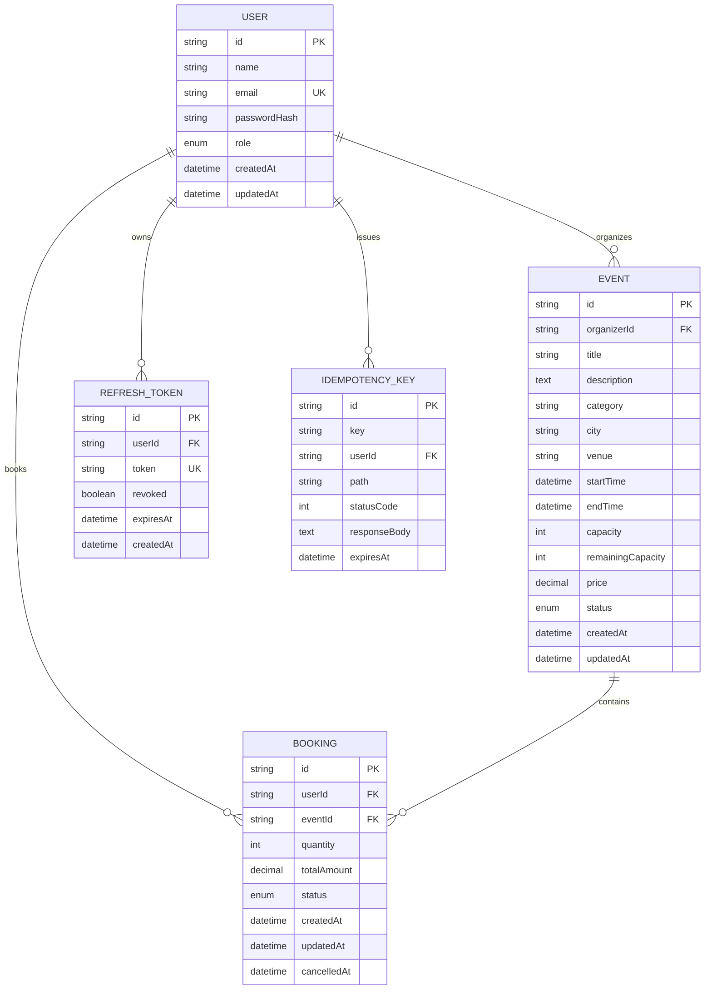

# 🎟️ EventFlow API

> Production-grade RESTful Event Ticketing Platform Backend built with Node.js, Express, TypeScript, PostgreSQL, and Prisma.

---

## 📌 Table of Contents
1. [Project Overview](#-project-overview)
2. [Key Features](#-key-features)
3. [Architecture & Design](#-architecture--design)
4. [Technology Stack](#-technology-stack)
5. [Database Schema](#-database-schema)
6. [API Endpoints Summary](#-api-endpoints-summary)
7. [Authentication & Token Lifecycle](#-authentication--token-lifecycle)
8. [Role-Based Access Control (RBAC)](#-role-based-access-control-rbac)
9. [🔥 How We Prevent Overbooking (Concurrency Strategy)](#-how-we-prevent-overbooking-concurrency-strategy)
10. [Cancellation & Refund Rules](#-cancellation--refund-rules)
11. [Idempotency Protection](#-idempotency-protection)
12. [Caching & Event Status Automation](#-caching--event-status-automation)
13. [Security & Rate Limiting](#-security--rate-limiting)
14. [Centralized Error Handling](#-centralized-error-handling)
15. [Getting Started & Local Setup](#-getting-started--local-setup)
16. [Docker & Docker Compose](#-docker--docker-compose)
17. [Database Migrations & Seed Data](#-database-migrations--seed-data)
18. [Testing & Verification](#-testing--verification)
19. [API Documentation (Swagger / OpenAPI)](#-api-documentation-swagger--openapi)
20. [Design Decisions & Trade-Offs](#-design-decisions--trade-offs)

---

## 🚀 Project Overview

**EventFlow API** is an event ticketing backend engine designed for high-concurrency ticket reservation workloads. It prevents overbooking and race conditions under simultaneous ticket purchase attempts, while enforcing role-based permissions, token rotation, cancellation deadlines, caching, and rate limiting.

---

## ✨ Key Features

- **Strict Concurrency Safety**: Guaranteed zero overbooking using database-level atomic conditional updates within ACID transactions.
- **Role-Based Access Control (RBAC)**: Enforced separation of concerns between `ATTENDEE` and `ORGANIZER` roles.
- **Resource Ownership Verification**: Organizers can only modify, cancel, or view statistics/bookings for events they own.
- **JWT Authentication with Refresh Token Rotation**: Secure short-lived access tokens with rotating single-use refresh tokens and automatic reuse detection/revocation.
- **Idempotent Bookings**: Support for `Idempotency-Key` headers to protect against accidental duplicate charges from network retries.
- **Search, Filtering & Pagination**: Multi-parameter event queries by category, city, price range, dates, seat availability, full search, and sort options.
- **Automated Event Lifecycle Jobs**: Periodic background cron tasks that transition event statuses from `UPCOMING` to `LIVE` and `COMPLETED`.
- **Intelligent Caching with In-Memory Fallback**: Redis integration with automatic fallback to an in-memory cache and automatic cache invalidation on writes.
- **Transactional Cancellation**: Attendees can cancel bookings prior to the configurable cancellation window (default: 2 hours before start), restoring seats atomically.
- **Organizer Analytics**: Real-time sales metrics, revenue calculations, remaining capacities, and breakdown of confirmed vs. cancelled orders.

---

## 🏗 Architecture & Design

EventFlow adheres to a clean **Layered Architecture** with strict separation of concerns:

```text
HTTP Request
     │
     ▼
[Security Middleware] ──────── (Helmet, CORS, Rate Limiters, Request ID, Request Logger)
     │
     ▼
[Routing Layer] ────────────── (Express Routers: /auth, /events, /bookings, /health)
     │
     ▼
[Auth & RBAC Middleware] ───── (JWT verification, Role guards: ATTENDEE / ORGANIZER)
     │
     ▼
[Validation Middleware] ────── (Zod request schema validation & sanitization)
     │
     ▼
[Controller Layer] ─────────── (HTTP Request/Response translation, status codes)
     │
     ▼
[Service Layer] ────────────── (Domain logic, cancellation rules, idempotency, caching)
     │
     ▼
[Repository Layer] ─────────── (Prisma ORM queries, raw atomic SQL transactions)
     │
     ▼
[PostgreSQL Database] ──────── (Relational tables, foreign keys, indexes, ACID safety)
```

---

## 🛠 Technology Stack

| Layer | Technology | Rationale |
| :--- | :--- | :--- |
| **Runtime** | Node.js (v20+) | High-throughput asynchronous I/O |
| **Language** | TypeScript | Static typing, compile-time safety, strict null checks |
| **Web Framework** | Express.js | Mature, lightweight, predictable middleware chain |
| **Database** | PostgreSQL | Robust ACID compliance, row-level locking, high concurrency |
| **ORM** | Prisma | Type-safe queries, schema migrations, raw SQL support |
| **Validation** | Zod | Runtime schema validation with structured error reports |
| **Authentication** | JWT + bcryptjs | Stateless authorization with salted password hashing |
| **Caching** | Redis / In-Memory | Sub-millisecond response caching with graceful fallback |
| **Scheduling** | node-cron | Reliable periodic background task processing |
| **Documentation** | OpenAPI 3.0 + Swagger UI | Standard interactive documentation available at `/docs` |
| **Testing** | Jest + Supertest | Unit, integration, and concurrency race-condition suites |
| **Containerization**| Docker & Docker Compose | Multi-stage production container build |

---

## 🗄 Database Schema



### Strategic Indexes:
- `User`: `email` (Unique lookup)
- `Event`: `category`, `city`, `status`, `startTime`, `organizerId`, `price` (Search, filtering, and ownership lookup)
- `Booking`: `userId` (History lookup), `eventId` (Event roster & stats), `status` (Order filtering), `createdAt` (Chronological sorting)
- `RefreshToken`: `token` (Unique verification), `userId` (Revocation)
- `IdempotencyKey`: Composite unique index on `(key, userId)`

---

## 📡 API Endpoints Summary

All API endpoints are prefixed with `/api/v1`.

### Authentication (`/api/v1/auth`)
| Method | Path | Access | Description |
| :--- | :--- | :--- | :--- |
| `POST` | `/auth/register` | Public | Register as `ATTENDEE` or `ORGANIZER` |
| `POST` | `/auth/login` | Public | Authenticate credentials and obtain token pair |
| `POST` | `/auth/refresh` | Public | Exchange refresh token for new access & refresh token |
| `POST` | `/auth/logout` | Authenticated | Revoke refresh token |
| `GET` | `/auth/me` | Authenticated | Get current authenticated user profile |

### Events (`/api/v1/events`)
| Method | Path | Access | Description |
| :--- | :--- | :--- | :--- |
| `GET` | `/events` | Public | Browse events with filters, search, sorting, and pagination |
| `GET` | `/events/:id` | Public | Get single event details |
| `POST` | `/events` | Organizer | Create a new event |
| `PATCH` | `/events/:id` | Organizer (Owner) | Update event details |
| `DELETE` | `/events/:id` | Organizer (Owner) | Delete event (only allowed if zero active bookings) |
| `POST` | `/events/:id/cancel`| Organizer (Owner) | Cancel event and mark bookings for refund |
| `GET` | `/events/:id/bookings`| Organizer (Owner) | View all attendee bookings for this event |
| `GET` | `/events/:id/stats` | Organizer (Owner) | View tickets sold, revenue, and capacity analytics |
| `POST` | `/events/:id/bookings`| Authenticated | Concurrency-safe ticket booking |

### Bookings (`/api/v1/bookings`)
| Method | Path | Access | Description |
| :--- | :--- | :--- | :--- |
| `GET` | `/bookings` | Authenticated | View authenticated user's booking history |
| `GET` | `/bookings/:id` | Authenticated | View booking details (Attendee owner or event organizer) |
| `POST` | `/bookings/:id/cancel`| Authenticated | Cancel booking and release reserved seats |

### System
| Method | Path | Access | Description |
| :--- | :--- | :--- | :--- |
| `GET` | `/health` | Public | System uptime and database connectivity probe |
| `GET` | `/docs` | Public | Interactive Swagger UI API documentation |

---

## 🔒 Authentication & Token Lifecycle

1. **Password Security**: Passwords are validated for complexity (uppercase, lowercase, number, min 8 chars) and hashed using `bcryptjs` with 10 salt rounds.
2. **Access Tokens**: Short-lived JWTs (15 minutes) containing `{ sub: userId, role, email }`.
3. **Refresh Tokens**: Single-use cryptographically strong tokens stored in the database.
4. **Token Rotation**: Every call to `/auth/refresh` revokes the submitted refresh token and issues a new pair.
5. **Reuse Detection**: If a revoked refresh token is presented, the system detects a potential breach and automatically revokes **all** active tokens for that user account.

---

## 🛡 Role-Based Access Control (RBAC)

Two primary roles exist in the system:
- **`ATTENDEE`**: Can browse events, book tickets, view personal booking history, and cancel eligible bookings.
- **`ORGANIZER`**: Can create events, manage their own events, view attendee lists for their events, and view event analytics.

Authorization is enforced at both the route middleware level (`authorize(Role.ORGANIZER)`) and within domain services (checking `event.organizerId === authenticatedUserId`). 

- If unauthenticated: returns **`401 UNAUTHORIZED`**.
- If authenticated but lacks role/ownership: returns **`403 FORBIDDEN`**.

---

## 🔥 How We Prevent Overbooking (Concurrency Strategy)

### The Problem: The "Read-Modify-Write" Race Condition

In naive implementations, ticket booking is written as:
1. Fetch `event` from the database.
2. Check if `event.remainingCapacity >= requestedQuantity`.
3. If yes, calculate `newCapacity = event.remainingCapacity - requestedQuantity`.
4. Save `newCapacity` back to the database.

#### Why this fails under load:
Suppose an event has only **2 seats remaining**.
- **User A** and **User B** send simultaneous booking requests for **2 seats each**.
- **Thread 1 (User A)** reads `remainingCapacity = 2`.
- **Thread 2 (User B)** reads `remainingCapacity = 2` before Thread 1 writes back.
- Thread 1 computes `2 - 2 = 0` and writes `remainingCapacity = 0`.
- Thread 2 computes `2 - 2 = 0` and writes `remainingCapacity = 0`.
- **Result**: **4 tickets were sold for an event with only 2 seats available!** (Overbooking / overselling).

---

### Our Solution: Conditional Atomic Database Update + ACID Transaction

In EventFlow, seat reservation and booking creation occur within a single database transaction using a **Conditional Atomic Update**:

```sql
UPDATE "Event"
SET "remainingCapacity" = "remainingCapacity" - $quantity,
    "updatedAt" = NOW()
WHERE "id" = $eventId
  AND "remainingCapacity" >= $quantity
  AND "status" = 'UPCOMING';
```

### Step-by-Step Flow:

```text
Client Request (POST /events/:id/bookings)
       │
       ▼
Start Database Transaction ($transaction)
       │
       ▼
Execute Conditional UPDATE Query with WHERE remainingCapacity >= quantity
       │
       ├─► [Rows Affected == 0]
       │       │
       │       └─► ROLLBACK Transaction ──► Return 409 Conflict ("Not enough seats available")
       │
       └─► [Rows Affected == 1]
               │
               ├─► Create Booking record (Status = 'CONFIRMED')
               │
               ├─► COMMIT Transaction
               │
               ├─► Invalidate Cache
               │
               └─► Return 201 Created ("Booking Confirmed")
```

#### Why This Is 100% Concurrency-Safe:
1. **Row-Level Write Locks in PostgreSQL**: When the `UPDATE` query executes on the target row, PostgreSQL acquires an exclusive row-level write lock.
2. **Atomic Predicate Evaluation**: The `WHERE "remainingCapacity" >= $quantity` condition is evaluated by the database engine at the exact moment the lock is held.
3. **No Intermediate State**: No other transaction can read an obsolete capacity value or decrement the capacity below zero.
4. **All-or-Nothing ACID Rollback**: If booking record creation fails for any reason after seat decrement, the transaction automatically aborts and the seats are instantly restored.

---

## 🔄 Cancellation & Refund Rules

1. **Attendee Cancellation**:
   - Attendees can only cancel their own bookings.
   - Cancellation is allowed only before the cancellation deadline:
     $$\text{Deadline} = \text{event.startTime} - \text{CANCELLATION\_DEADLINE\_HOURS (default 2 hours)}$$
   - When cancelled, the booking status is set to `CANCELLED`, `cancelledAt` is set to `NOW()`, and the reserved seats are atomically credited back to `remainingCapacity`.
   - Idempotent state check prevents duplicate cancellation requests from crediting seats multiple times.

2. **Organizer Event Cancellation**:
   - An organizer can cancel their own event at any time.
   - All confirmed bookings under the event are automatically marked `REFUNDED` inside a single atomic transaction.
   - The event status becomes `CANCELLED`, blocking any future booking attempts.

---

## 🔑 Idempotency Protection

Clients can attach an optional `Idempotency-Key` header:
```http
POST /api/v1/events/550e8400-e29b-41d4-a716-446655440000/bookings
Idempotency-Key: pay_req_99812401
```
- If the network drops and the client retries with the same `Idempotency-Key`, EventFlow detects the existing key and returns the saved response payload without performing duplicate seat decrements or creating duplicate bookings.

---

## ⚡ Caching & Event Status Automation

- **Response Caching**: Public event listings and event detail queries are cached using Redis with an automatic in-memory fallback.
- **Cache Invalidation**: Creating, updating, booking, or cancelling an event immediately invalidates the corresponding cache keys.
- **Automated Lifecycle Transitions**: A background cron job (`node-cron`) runs every minute to transition event statuses:
  - `UPCOMING` $\rightarrow$ `LIVE` (when current time reaches `startTime`)
  - `LIVE` / `UPCOMING` $\rightarrow$ `COMPLETED` (when current time passes `endTime`)

---

## 🛡 Security & Rate Limiting

- **HTTP Security Headers**: Powered by `helmet` with custom Content Security Policy (CSP).
- **CORS Support**: Configurable allowed origins via `CORS_ORIGIN`.
- **IP & User Rate Limiting**:
  - Global API limiter (100 req/min)
  - Auth limiter (15 attempts/min)
  - Booking limiter (10 attempts/min per user)
- **Input Sanitization & Validation**: Strong validation on all input vectors with Zod schemas.
- **Sensitive Data Redaction**: Loggers automatically mask passwords, hashes, and authorization tokens.

---

## ⚠️ Centralized Error Handling

All errors follow a standardized JSON envelope:

```json
{
  "success": false,
  "error": {
    "code": "INSUFFICIENT_CAPACITY",
    "message": "Not enough seats available. Requested: 3, Remaining: 1"
  }
}
```

### Standard Status Codes:
- `200 OK` / `201 CREATED` / `204 NO CONTENT`
- `400 BAD REQUEST` (Validation error or invalid operation)
- `401 UNAUTHORIZED` (Missing or invalid JWT token)
- `403 FORBIDDEN` (Lacks role or resource ownership)
- `404 NOT FOUND` (Event or booking does not exist)
- `409 CONFLICT` (Sold out, overbooking prevented, or email duplicate)
- `429 TOO MANY REQUESTS` (Rate limit exceeded)
- `500 INTERNAL SERVER ERROR` (Safe unhandled exception response)

---

## 💻 Getting Started & Local Setup

### Prerequisites
- Node.js (v18 or v20+)
- PostgreSQL (v14+)
- npm or pnpm

### 1. Clone & Install Dependencies
```bash
git clone <repository-url>
cd eventflow-api
npm install
```

### 2. Configure Environment Variables
Copy `.env.example` to `.env`:
```bash
cp .env.example .env
```

### 3. Setup Database & Prisma
```bash
# Generate Prisma Client
npm run prisma:generate

# Push schema to database / run migrations
npm run prisma:push

# Populate database with realistic test seed data
npm run prisma:seed
```

### 4. Start Development Server
```bash
npm run dev
```
The server will start at `http://localhost:3000`.

---

## 🐳 Docker & Docker Compose

To run the complete stack (API + PostgreSQL + Redis) using Docker:

```bash
# Start all containers in background
docker compose up -d

# View API logs
docker compose logs -f api

# Stop all containers
docker compose down
```

---

## 🧪 Testing & Verification

EventFlow includes comprehensive test suites:
- **Unit Tests**: Business logic in isolation.
- **Integration Tests**: Supertest HTTP route, authentication, and validation testing.
- **Concurrency Race-Condition Tests**: Simulating concurrent booking surges.

### Run All Tests:
```bash
npm run test
```

### Run Concurrency Tests Specifically:
```bash
npm run test:concurrency
```

### Test Results:
```text
PASS tests/integration/events.api.test.ts
PASS tests/integration/auth.api.test.ts
PASS tests/concurrency/bookingConcurrency.test.ts
PASS tests/unit/booking.service.test.ts
PASS tests/unit/auth.service.test.ts
PASS tests/integration/bookings.api.test.ts

Test Suites: 6 passed, 6 total
Tests:       19 passed, 19 total
```

---

## 📚 API Documentation (Swagger / OpenAPI)

Interactive Swagger UI documentation is available directly at:
```text
http://localhost:3000/docs
```
The raw OpenAPI 3.0 specification is located in `docs/openapi.yaml`.

---

## 👥 Pre-Seeded Test Credentials

| Role | Name | Email | Password |
| :--- | :--- | :--- | :--- |
| **ORGANIZER** | DevNexus Events | `organizer1@eventflow.dev` | `Password123!` |
| **ORGANIZER** | Vibrant Sound Experiences | `organizer2@eventflow.dev` | `Password123!` |
| **ATTENDEE** | Aarav Sharma | `aarav@eventflow.dev` | `Password123!` |
| **ATTENDEE** | Diya Patel | `diya@eventflow.dev` | `Password123!` |
| **ATTENDEE** | Rohan Iyer | `rohan@eventflow.dev` | `Password123!` |

---

## ⚖️ Design Decisions & Trade-Offs

1. **Atomic Conditional Update vs. Pessimistic Locking (`SELECT FOR UPDATE`)**:
   - We selected atomic conditional SQL updates (`UPDATE ... WHERE remaining_capacity >= qty`) because it avoids holding locks during application query planning, reduces deadlock surface, and performs exceptionally well on modern PostgreSQL engines.
2. **In-Memory Cache Fallback**:
   - Rather than making Redis a hard failure dependency for local developer evaluations, the cache adapter automatically falls back to an in-memory TTL cache if Redis is not reachable.
3. **Structured Domain Error Hierarchy**:
   - `AppError` provides machine-readable `ErrorCode` enums while preventing internal SQL details or stack traces from ever leaking to API clients in production.
# Eventflow-Api

